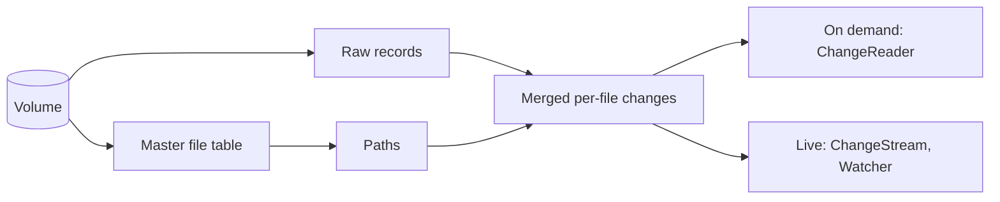

# usn-journal

[](https://github.com/fivelayer-dev/usn-journal/actions/workflows/ci.yml)

Read the Windows USN change journal from Rust.

NTFS and ReFS volumes can keep a log of every change to every file. This crate
reads that log, so a program can find out what changed without walking the whole
volume. Indexers, sync tools and backup software are the usual users.

- **Layered.** Read raw records, get merged per-file changes with full paths, or
  use anything in between.
- **Resumable.** Save a cursor as text and carry on later with nothing missed.
- **Honest about loss.** If the journal no longer covers the time you were away,
  you are told, rather than quietly given an incomplete answer.
- **Read-only by default.** Creating or deleting a journal needs a feature flag.
- **One dependency,** `windows-sys`.

## Installing

The crate isn't on crates.io yet, so depend on the repository:

```toml
[dependencies]
usn-journal = { git = "https://github.com/fivelayer-dev/usn-journal" }
```

## What's in it

Each layer can be used on its own.

| Layer | Type | Use it to |
|---|---|---|
| Volume | `Volume` | Open a volume and query its journal |
| Records | `Volume::records` | Read raw journal records, filtered by reason if you like |
| Listing | `Volume::mft_entries`, `Volume::scan` | List every file on the volume |
| Paths | `PathResolver` | Turn raw records into full paths |
| On-demand changes | `ChangeReader` | Ask what changed up to a position |
| Live changes | `ChangeStream`, `Watcher` | Follow changes as they happen |
| Health | `Volume::health` | See how much history a journal holds |



## Asking what changed since last time

```rust,no_run
use usn_journal::{ChangeOptions, ChangeReader, Cursor, PathFilter, Result, Start, Volume};

fn changes_since(saved: Option<&str>) -> Result<String> {
    let volume = Volume::open("D:")?;
    let cursor = match saved {
        Some(text) => text.parse::<Cursor>()?,
        None => {
            // First run: list everything. Anything that changes during the
            // listing is picked up from this cursor, so nothing slips through.
            let scan = volume.scan(&PathFilter::new())?;
            let start = scan.start_cursor();
            for entry in scan {
                println!("{:?}", entry?.path);
            }
            start
        }
    };

    let mut reader = ChangeReader::new(volume, Start::At(cursor), ChangeOptions::new())?;
    let batch = reader.read_to_end()?;
    if batch.gap.is_some() {
        // The journal no longer covers the whole period, so list the volume again.
    }
    for change in &batch.changes {
        println!("{} {:?}", change.kind, change.path);
    }
    // Save this only once the batch is safely handled.
    Ok(batch.cursor.to_string())
}
```

## Following changes as they happen

```rust,no_run
use usn_journal::{
    ChangeOptions, ChangeStream, Result, SettleOptions, Start, Volume, WatchEvent, WatchOptions,
};

fn follow() -> Result<()> {
    let volume = Volume::open("C:")?;
    let stream = ChangeStream::new(volume, Start::Now, ChangeOptions::new(), SettleOptions::new())?;
    let watcher = stream.watch(WatchOptions::new())?;
    for event in watcher.events() {
        match event {
            WatchEvent::Batch(batch) => {
                for change in &batch.changes {
                    println!("{} {:?}", change.kind, change.path);
                }
            }
            WatchEvent::Retrying(error) => eprintln!("retrying: {error}"),
            WatchEvent::Stopped(error) => return Err(error),
        }
    }
    Ok(())
}
```

## What you can rely on

- **Nothing reported is lost.** A cursor never moves past a change that hasn't been
  reported, so resuming from a saved cursor can repeat a change but never miss one.
- **Lost history is reported.** If records were purged or the journal was recreated,
  the batch has a `gap`, and only a fresh listing can catch up.
- **A change is a prompt to look at the file.** The file may have changed again since.
- **Identify files by `id`.** It survives renames, and a deleted file can have no path.

[Tracking changes reliably](https://github.com/fivelayer-dev/usn-journal/blob/main/docs/tracking-changes.md)
covers the rules in full, including how to pair changes with a frozen copy of a volume.

## Requirements

- Windows. The crate compiles elsewhere so that portable code can depend on it, but
  only its value types are available there.
- An elevated process to read a journal with file names.
  `Volume::open_unprivileged` needs no elevation, but its records have no names, so
  its changes have no paths and files are told apart by `id`.
- A volume with a journal. This crate never creates one unless you ask, with the
  `journal-admin` feature.

## From other languages

[`usn-watch`](https://github.com/fivelayer-dev/usn-journal/tree/main/crates/usn-watch)
is a small program that writes the same information as JSON Lines on stdout.

## Contributing

See [CONTRIBUTING.md](https://github.com/fivelayer-dev/usn-journal/blob/main/CONTRIBUTING.md).

## License

Licensed under either of [Apache License, Version 2.0](LICENSE-APACHE) or
[MIT license](LICENSE-MIT) at your option.

Unless you explicitly state otherwise, any contribution intentionally submitted for
inclusion in this work by you, as defined in the Apache-2.0 license, shall be dual
licensed as above, without any additional terms or conditions.
