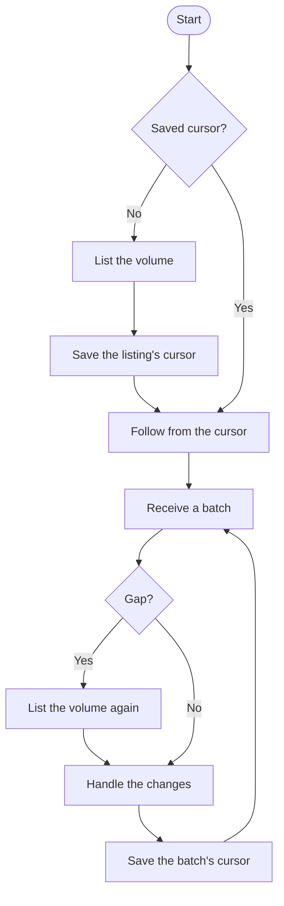
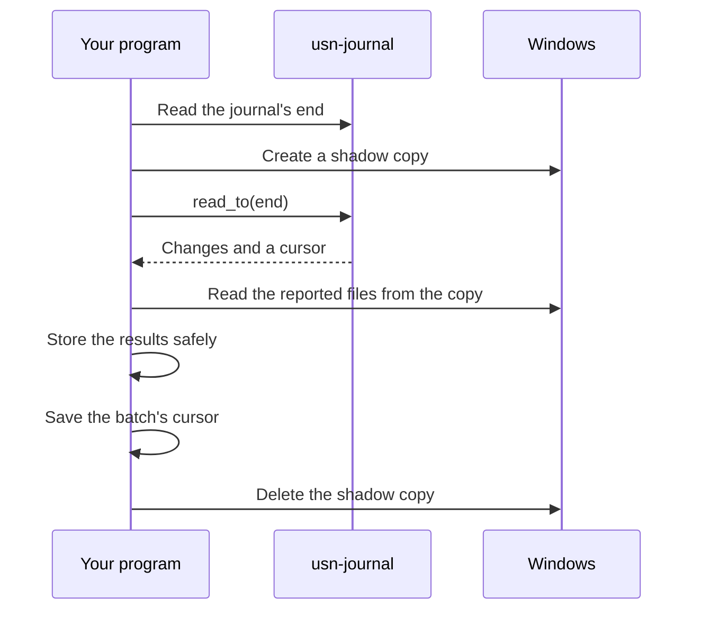

# Tracking changes reliably

This guide is for programs that keep something in step with a volume, such as a
search index, a sync tool or a backup. It covers the rules that keep such a program
correct, the two ways to read changes, and the limits of the journal.

`usn-journal` only says what changed. Reading files, storing results, scheduling and
freezing a volume are up to your program.

## The rules

1. **List the volume on first run.** The journal only covers recent changes, so it
   can't tell you what already exists. Use `Volume::scan`.
2. **Save the cursor only after a batch is safely handled.** A crash then repeats some
   work but loses nothing. Write it atomically.
3. **Expect repeats.** The same change can be reported twice, so handling one must be
   safe to repeat.
4. **Treat a gap as lost changes.** The journal can no longer say what changed, so list
   the volume again before saving the cursor.
5. **Treat a change as a prompt to look at the file.** It may have changed again or be
   gone by the time you read it.
6. **Identify files by `id`.** It survives renames. A path doesn't, and a deleted file
   can have no path at all.

## Handling each change

| `kind` | What it means | What to do |
|---|---|---|
| `Created` | It appeared | Read it |
| `Modified` | Its contents changed | Read it |
| `Renamed` | Only its path changed | Update the path. For a directory, update everything under it |
| `MetadataChanged` | Attributes, permissions or similar | Refresh those |
| `Deleted` | It is gone | Remove it |

`Created` also covers a move into the area your filter keeps, and a move from somewhere
that can no longer be determined. `Deleted` also covers a move out of that area.

Batches list deletes first, so applying a batch in order leaves the right file in place
when one file replaces another at the same path.

```rust,no_run
use usn_journal::{ChangeKind, FileChange, Result};

fn handle(change: &FileChange) -> Result<()> {
    match change.kind {
        ChangeKind::Created | ChangeKind::Modified if change.has_new_content() => {
            // Read change.path.
        }
        ChangeKind::Created | ChangeKind::Modified => {
            // A directory or a link, so there are no contents to read.
        }
        ChangeKind::Renamed => {
            // Move change.previous_path to change.path in your records.
        }
        ChangeKind::MetadataChanged => {
            // Refresh attributes, permissions and similar.
        }
        ChangeKind::Deleted => {
            // Find the file by change.id, or by change.path if you index paths.
        }
    }
    Ok(())
}
```

Return an error if reading fails for a reason other than the file being gone, so that
the cursor isn't saved past it.

## Choosing how to read changes

| | `ChangeStream` | `ChangeReader` |
|---|---|---|
| **How it works** | Follows the journal and reports files once they settle | Reports everything up to a position when you ask |
| **Delay** | Seconds | Your schedule |
| **Suits** | Near-real-time updates | Work done in cycles, or from a frozen copy |

### Following the journal

A file is ready to report once it has closed and stayed untouched for the settle period
(2 seconds by default), or has stayed open for the maximum delay (5 minutes by default).
A file reported while still open has `still_open` set, and is reported again when it
closes. A file created and deleted before it is reported is never mentioned.



```rust,no_run
use usn_journal::{
    ChangeOptions, ChangeStream, Cursor, FileChange, PathFilter, Result, SettleOptions, Start,
    Volume, WatchEvent, WatchOptions,
};

fn list_everything(filter: &PathFilter) -> Result<Cursor> {
    let volume = Volume::open("D:")?;
    let scan = volume.scan(filter)?;
    // This cursor was taken before the listing began, so nothing can slip
    // between the listing and the changes that follow it.
    let cursor = scan.start_cursor();
    for entry in scan {
        let entry = entry?;
        if !entry.is_directory() && !entry.is_link() {
            // Read entry.path if it differs from what you hold.
        }
    }
    Ok(cursor)
}

fn handle(_change: &FileChange) -> Result<()> {
    Ok(())
}

fn run(saved: Option<Cursor>, save: impl Fn(Cursor) -> Result<()>) -> Result<()> {
    let filter = PathFilter::new().exclude_system_files();
    let cursor = match saved {
        Some(cursor) => cursor,
        None => {
            let cursor = list_everything(&filter)?;
            save(cursor)?;
            cursor
        }
    };

    let options = ChangeOptions::new().filter(filter.clone());
    let volume = Volume::open("D:")?;
    let stream = ChangeStream::new(volume, Start::At(cursor), options, SettleOptions::new())?;
    let watcher = stream.watch(WatchOptions::new())?;

    for event in watcher.events() {
        match event {
            WatchEvent::Batch(batch) => {
                if batch.gap.is_some() {
                    list_everything(&filter)?;
                }
                for change in &batch.changes {
                    handle(change)?;
                }
                save(batch.cursor)?;
            }
            WatchEvent::Retrying(error) => eprintln!("retrying: {error}"),
            WatchEvent::Stopped(error) => return Err(error),
        }
    }
    Ok(())
}
```

Dropping the watcher stops it. Changes still settling aren't lost, because they are read
again from the last saved cursor.

### Reading in cycles from a frozen copy

Live files can be locked or half written. A volume shadow copy gives you one consistent
moment instead, and `Volume::open` accepts a copy's device path. A shadow copy is frozen,
so changes are read from the live volume, up to a position taken just before the copy.

Read the position **before** freezing, so that every reported change is in the copy.



```rust,no_run
use usn_journal::{ChangeReader, Cursor, PathFilter, Result, Volume};

// Provided by your program.
fn create_shadow_copy() -> Result<String> {
    unimplemented!()
}
fn delete_shadow_copy(_device: &str) {}

fn cycle(
    reader: &mut ChangeReader,
    filter: &PathFilter,
    save: impl Fn(Cursor) -> Result<()>,
) -> Result<()> {
    let end = reader.volume().journal_info()?.end_cursor();
    let device = create_shadow_copy()?;

    let batch = reader.read_to(end)?;
    if batch.gap.is_some() {
        // This lists the copy, and its paths point inside it. Save the batch's
        // cursor below rather than the one from this scan, so that changes made
        // after the copy was taken aren't lost.
        let copy = Volume::open(&device)?;
        for entry in copy.scan(filter)? {
            let _ = entry?;
        }
    }
    for change in &batch.changes {
        // Read the path from the copy. If it isn't there, skip it, because
        // the next cycle reports why.
        let _ = change;
    }

    // Store the results safely before this line.
    save(batch.cursor)?;
    delete_shadow_copy(&device);
    Ok(())
}
```

Create the reader once with `Start::At(saved)` and reuse it for every cycle, which avoids
reloading the directory list each time.

Things to expect in a cycle:

- **A change made between the position and the copy** is reported again next cycle.
- **A path missing from the copy** was renamed or deleted after the position. Skip it,
  because the next cycle reports that change.
- **A `still_open` file** was being written at the position. Its copy may be incomplete,
  and it's reported again when it closes.
- **A cursor that isn't exactly the position** is normal. It stays before a file caught
  halfway through a rename, and can land just past the position after padding in the
  journal, with nothing skipped.

## Choosing what to report

```rust
use usn_journal::PathFilter;

let filter = PathFilter::new()
    .exclude_system_files()
    .include(r"Users\someone\Documents")
    .exclude(r"Users\someone\Documents\cache");
```

- Paths are relative to the volume root, ignore case and match whole path components.
  A directory covers everything beneath it. There are no wildcards.
- With no includes, everything is reported except what is excluded. With includes, only
  those paths are reported, plus the directories leading to them, so renaming a parent
  of an included folder is still noticed.
- Excludes always win.
- A moved-in directory gets one change, so list its contents yourself.

## Links

Links are reported but never followed. A change made through a link appears at the real
file's path, if that file is on the volume being read.

| Type | Reported as | `has_new_content` |
|---|---|---|
| Symbolic link to a file | `is_link`, a file | `false` |
| Symbolic link to a directory, or a junction | `is_link`, a directory | `false` |
| Cloud placeholders and other reparse points that hold data | `is_reparse_point`, not `is_link` | as for any file |
| A reparse point whose kind can't be read | `is_reparse_point`, not `is_link` | as for any file |

The link's target is not reported, so read that yourself if you need it.

## Watching the journal's health

Check health periodically, and raise an alert or plan a listing based on the result.

```rust,no_run
use std::time::Duration;
use usn_journal::{Cursor, HealthOptions, Result, Volume};

fn check(cursor: Cursor) -> Result<()> {
    let options = HealthOptions::new()
        .cursor(cursor)
        .required_history(Duration::from_secs(72 * 3600));
    let health = Volume::open("D:")?.health(&options)?;
    for issue in &health.issues {
        eprintln!("{}: {issue}", issue.kind());
    }
    Ok(())
}
```

| Issue | Status | Meaning | What to do |
|---|---|---|---|
| `cursor_lost` | critical | The saved cursor can't be read | List the volume again |
| `cursor_at_risk` | warning | The saved cursor may be purged soon | Catch up now |
| `short_history` | warning | The journal holds less than you asked for | Enlarge the journal |
| `usn_near_limit` | warning | The journal is nearing its maximum position | Plan to recreate it, then list the volume |

The write rate and capacity are averages that leave out any silence longer than ten
minutes, because time a machine is off doesn't use the journal up. A burst of activity
uses it up faster, so leave a margin.

## Known limits

- **Offline time is limited by journal size.** The oldest records are purged, and the
  next run then reports a gap. `Volume::health` says how long yours lasts, and
  `Volume::create_journal` can enlarge it, with the `journal-admin` feature.
- **ReFS can't list itself.** Windows has no master file table listing there, so
  `Volume::scan` fails with `Error::Unsupported`, and a first listing has to walk the
  directories instead. Changes still work, with directories looked up as needed.
- **Hard links appear under one name.** A change is reported under a single name, which
  may not be the one you expect. A scan can list a file with two names only once, and if
  that name is excluded the file is skipped even if its other name is included. Find the
  other names with `FindFirstFileNameW`.
- **Moving a directory is one change.** Update everything under the old path yourself.
- **Starting after a reboot can be slow on a large volume,** because the directories are
  read from the master file table. `ChangeOptions::preload_directories(false)` avoids it,
  but a deleted file may then have no path.
- **Long-open files are a poor fit.** Virtual disks and databases stay open and change
  constantly, so the journal can't tell you when they are consistent.
- **Changes aren't byte ranges.** The journal says a file changed, and this crate doesn't
  yet report which parts.
